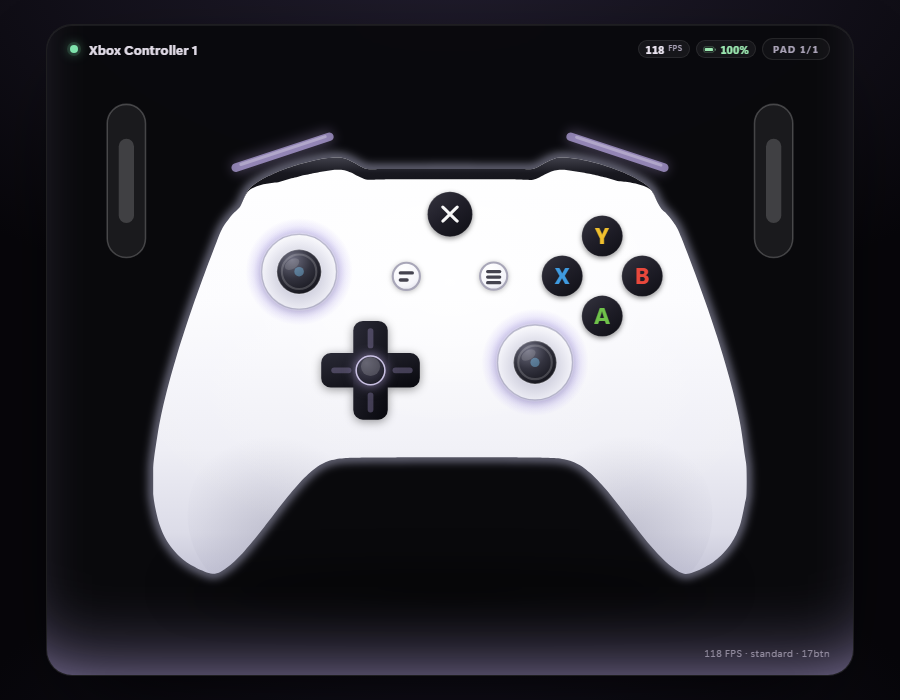

# Gamepad Overlay

**手柄按什么键，屏幕上就亮什么。** 一个常驻桌面、可鼠标穿透的 HTML 手柄浮层，用来录攻略 / 直播 / 复盘操作。

*A lightweight Windows overlay that shows your controller's inputs on screen in real time — buttons, triggers, sticks, plus live FPS and battery. Transparent, always-on-top, click-through, single exe, no installer.*



[](#环境要求)
[](#从源码构建)
[](LICENSE)

---

## 下载

**[Releases](../../releases)**

1. 解压至任意位置
2. 双击 `一键启动.bat`（或只启动浮层：`启动浮层.bat`）

> 下载的zip文件解压前需**右键 → 属性 → 解除锁定**

## 功能

- **按键实时点亮** —— 支持ABXY、肩键、扳机、十字键、摇杆
- **模拟量显示** —— 扳机行程、摇杆方向均可见
- **置顶 + 鼠标穿透** —— 覆盖于游戏上方，点击直接穿入游戏；`Ctrl+Alt+O` 随时切换
- **实时帧率 + 手柄电量显示** —— 右上角常驻
- **45% ~ 140% 七档缩放**
- **自动识别手柄** —— Xbox 手柄连接时显示 ABXY，连接DualSense 则自动转变为 ✕ ○ □ △ 和 PS 配色
- **位置随意摆放** —— 位置、大小、穿透状态存于 `settings.ini`，重启后重置
- **用于obs** —— 透明 / 深色 / 绿幕三种底色，用于窗口采集或色度键均可

> 按住手柄任意键时，卡片左下角会弹出按键胶囊
> 用于录制：[按键点亮效果](_shots/overlay-keys.png)。
> 缩小至 **55%** ：[小尺寸](_shots/overlay-small.png)；
> 使用 PS 手柄时自动切换键色：[PS 主题](_shots/overlay-ps.png)；
> 电量掉至 20% 以下时整体转红并有呼吸效果：[低电量](_shots/overlay-lowbat.png)。

### 设计

- 白色 Xbox 机身，轮廓和按键位置使用**真机对照**（宽高比 1.416），
  左右两半严格镜像对称；描边采用亚像素采样 + 高斯平滑，无锯齿
- 肩键 LB / RB 悬于上方，显示为两条紫色光条，LT / RT 竖于两侧
- D-pad使用暗件 + 发光缝，摇杆使用白色凹槽 + 深色帽

## 使用

启动后浮层默认出现在**屏幕右上角**，900×700。退出可使用快捷键`Ctrl + Alt + X`，或点击托盘图标右键退出。

### 全局快捷键

| 快捷键 | 作用 |
| --- | --- |
| `Ctrl + Alt + O` | 切换鼠标穿透 |
| `Ctrl + Alt + T` | 切换窗口置顶 |
| `Ctrl + Alt + W / A / S / D` | 上 / 左 / 下 / 右 挪 12px（穿透开着也能挪） |
| `Ctrl + Alt + [` / `]` | 缩小 / 放大一档 |
| `Ctrl + Alt + X` | 退出 |

### 托盘菜单

| 菜单项 | 作用 |
| --- | --- |
| 鼠标穿透 / 窗口置顶 | 同上两个开关 |
| 吸附位置 | 四角 / 屏幕正中 / **移到鼠标位置** |
| 位置微调 | 点击↑↓←→，每次移动 12px |
| 摇杆 Y 轴反向 |
| 大小 | 45% / 55% / 70% / 85% / 100% / 120% / 140% |
| 深色底色 / 绿幕底色 / 透明底色 | 用于OBS，默认为透明 |
| 退出 | 关掉浮层 |

> 摆放至任意位置：`Ctrl+Alt+O` 关闭穿透 → 拖动标题栏 → 恢复穿透。

---

## 帧率和电量

| 显示 | 含义 |
| --- | --- |
| `118 FPS` | **前台游戏帧率**，由 RTSS 共享内存读取 |
| `235 Hz` | 无法获得帧率时浮层自己的刷新率（≈ 显示器刷新率） |
| `100%` | 手柄电量，≤20% 变红并产生呼吸效果，21–45% 暖黄，46% 以上绿色，无法获得数据时显示 `--` |

**帧率**读取 **RivaTuner Statistics Server（RTSS）** 的共享内存 `RTSSSharedMemoryV2`，
根据前台窗口 PID 查询 `帧率 = frames / (time1 - time0)`，每 0.4 秒刷新一次。
未安装RTSS则显示浮层本身 `Hz`，其余功能不受影响。

**电量**由**蓝牙设备属性**获得，USB 直连或使用 Xbox 无线适配器会显示 `--`。

## 命令行参数

```
GamepadOverlay.exe [--anchor=tl|tr|bl|br|c] [--x=.. --y=..] [--margin=12]
                   [--w=900] [--h=700] [--scale=1.0]
                   [--opaque] [--no-click-through] [--no-top] [--query="theme=ps&demo=1"]
```

| 参数 | 说明 |
| --- | --- |
| `--anchor=` | 初始吸附位置（默认 `tr`） |
| `--x= --y=` | 直接指定左上角坐标 |
| `--margin=` | 吸附时距离屏幕边缘的像素（默认 12，`0` 就是贴死） |
| `--w= --h=` | 窗口尺寸（默认 900×700） |
| `--scale=` | 内容缩放 0.45–1.4 |
| `--opaque` | 实心底色（等价托盘里的「深色底色」），给 OBS 窗口采集 |
| `--no-click-through` | 启动时不开启鼠标穿透 |
| `--no-top` | 启动时不置顶 |
| `--query=` | 透传给页面的参数，调试用（`demo=1` 假手柄、`theme=ps`、`bat=8` 等） |

## 直播

- **透明叠加**：`来源 → 窗口采集` 选 `Gamepad Overlay`，勾选「允许透明度」，方法选择 **Windows 10 (1903 及以上)**
- **绿幕**：托盘 → 绿幕底色，采集后添加「色度键」滤镜，键色 `#00FF00`
- **深色底**：托盘 → 深色底色，适合不透明的小窗口叠加

## 从源码构建

需要 Windows 10/11 + .NET Framework 4.0（系统自带），不需要装 SDK。

```powershell
git clone <改成你自己的仓库地址>
cd gamepad-overlay
powershell -ExecutionPolicy Bypass -File .\build.ps1
```

`build.ps1` 会发现缺 WebView2 DLL，自动调用 `get-deps.ps1` 去 NuGet 拉 SDK 并取出三个文件：

| 文件 | 来源 |
| --- | --- |
| `Microsoft.Web.WebView2.Core.dll` | `lib\net462\` |
| `Microsoft.Web.WebView2.WinForms.dll` | `lib\net462\` |
| `WebView2Loader.dll` | `runtimes\win-x64\native\` |

> `csc.exe` 用的是 .NET Framework 4.0 那个，**只支持 C# 5** —— 改 `src/Overlay.cs` 时不能写
> `$"..."` 插值、`?.`、表达式体成员。

## 原理

```
XInput (xinput1_4.dll)          ┌──────────────┐   JSON via postMessage   ┌──────────────┐
  ──► 后台线程每 16ms 轮询 ──►  │ GamepadOverlay│ ──────────────────────► │  WebView2    │
实时帧率 (RTSS 共享内存)        │   .exe (C#)   │                         │ index.html   │
蓝牙电量 (cfgmgr32)             └──────────────┘ ◄──── ready / rect ───── └──────────────┘
```

- 页面**HTML + SVG + JS**，单文件零依赖，可直接用浏览器打开预览
- 透明依靠 `TransparencyKey`（品红抠像）+ `DefaultBackgroundColor = Transparent` 实现**逐像素透明**
- 窗口使用 `WS_EX_TOOLWINDOW | WS_EX_NOACTIVATE | WS_EX_TRANSPARENT`，每 1.2 秒重新置顶
- 页面会将卡片的实际矩形上报给宿主，宿主据此做像素级贴边

## 已知限制

- **独占全屏（Exclusive Fullscreen）无法覆盖**
  将游戏改成「窗口化 / 无边框窗口」即可（如BeamNG：`Options → Graphics → Display Mode → Window`）。
- **仅支持 XInput 手柄**（Xbox 系列及绝大多数第三方）。纯 DirectInput 的老手柄无法读取。
- **电量仅在蓝牙连接时可用**（见上文）。

## License

[MIT](LICENSE) 

## 致谢

- 帧率数据来自 [RTSS](https://www.guruguru3d.com/files-details/rtss-rivatuner-statistics-server-download.html) 的共享内存
- 界面基于 Microsoft Edge WebView2
